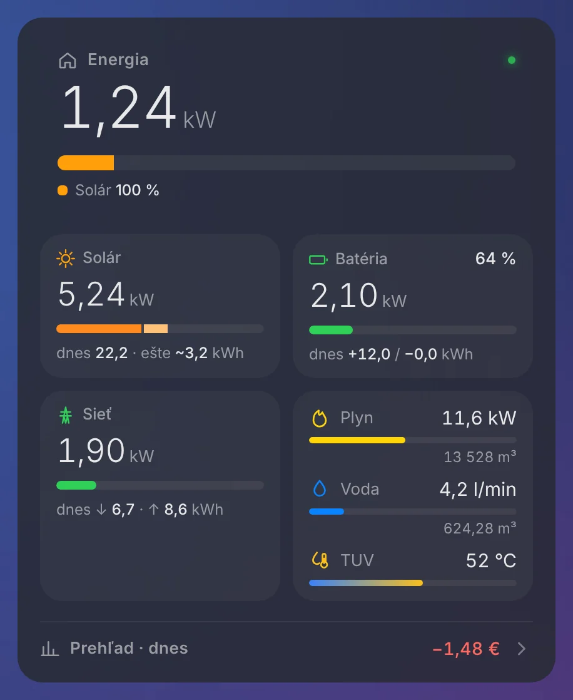
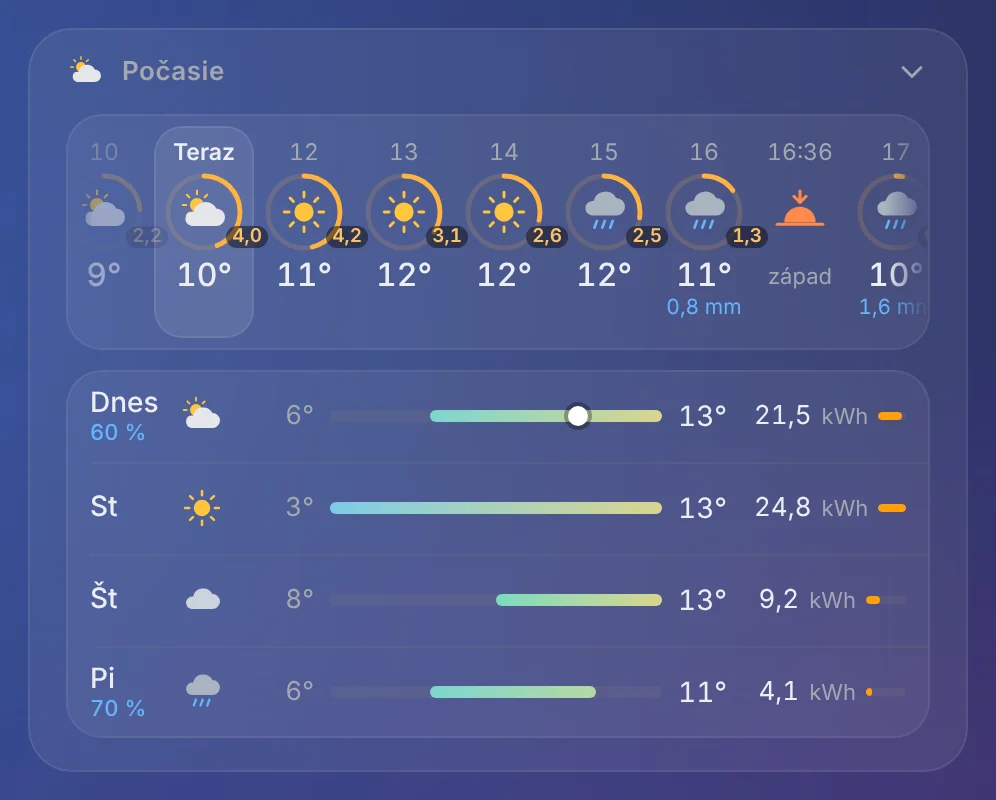
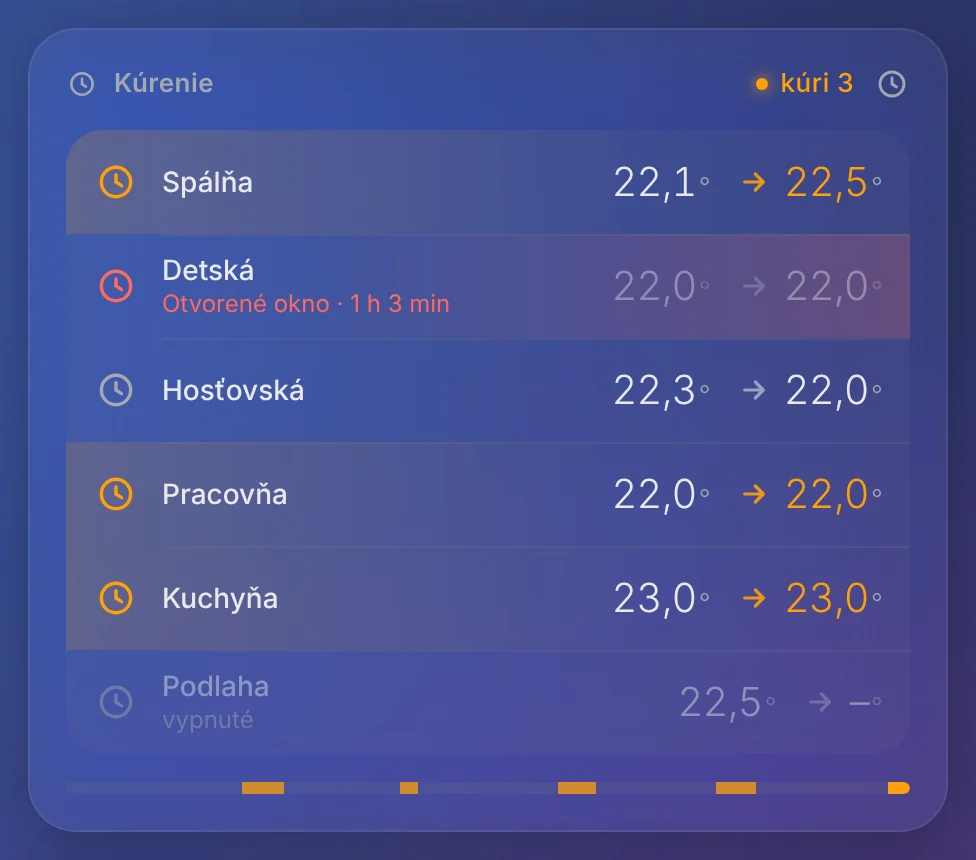
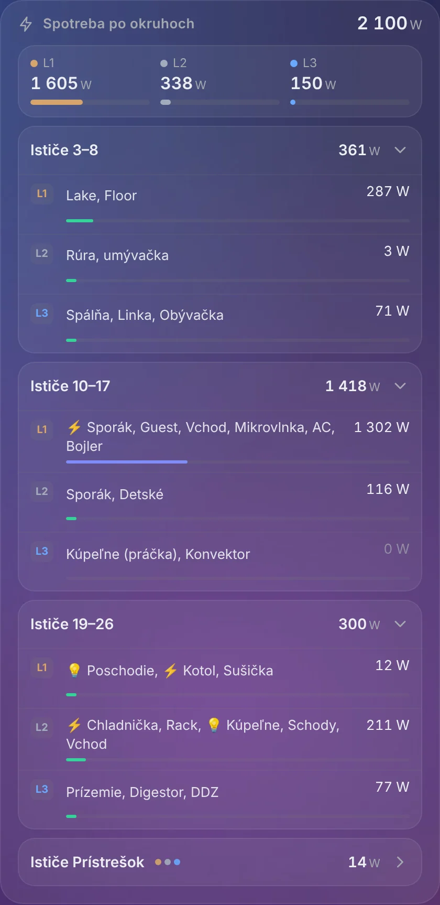
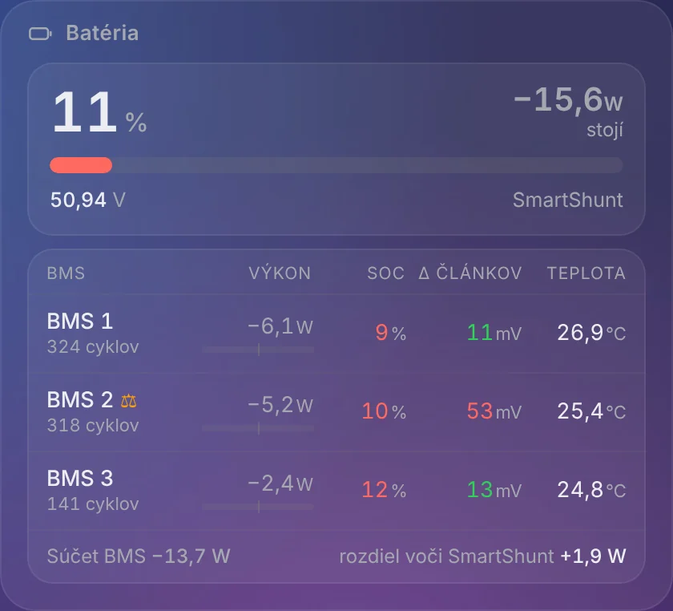
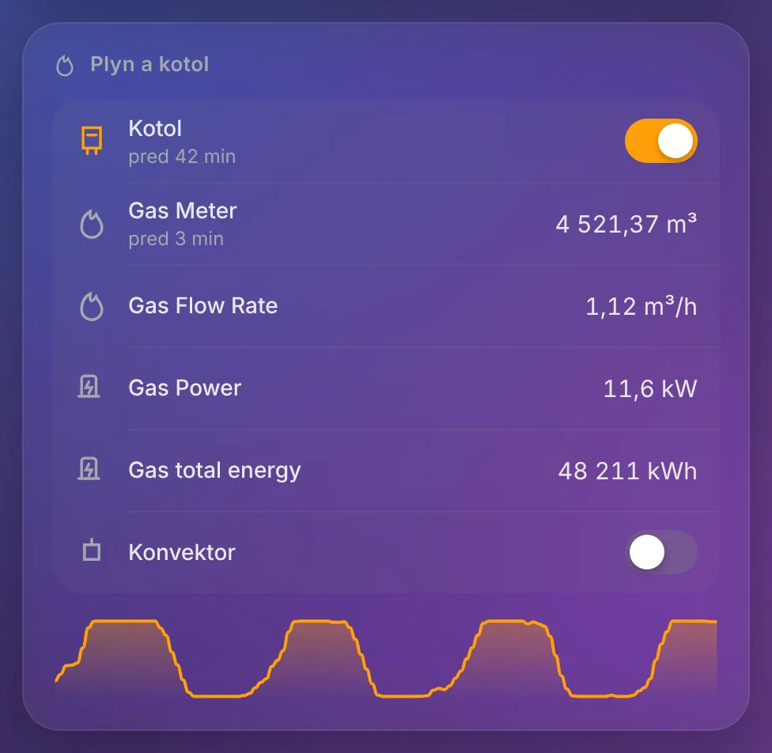
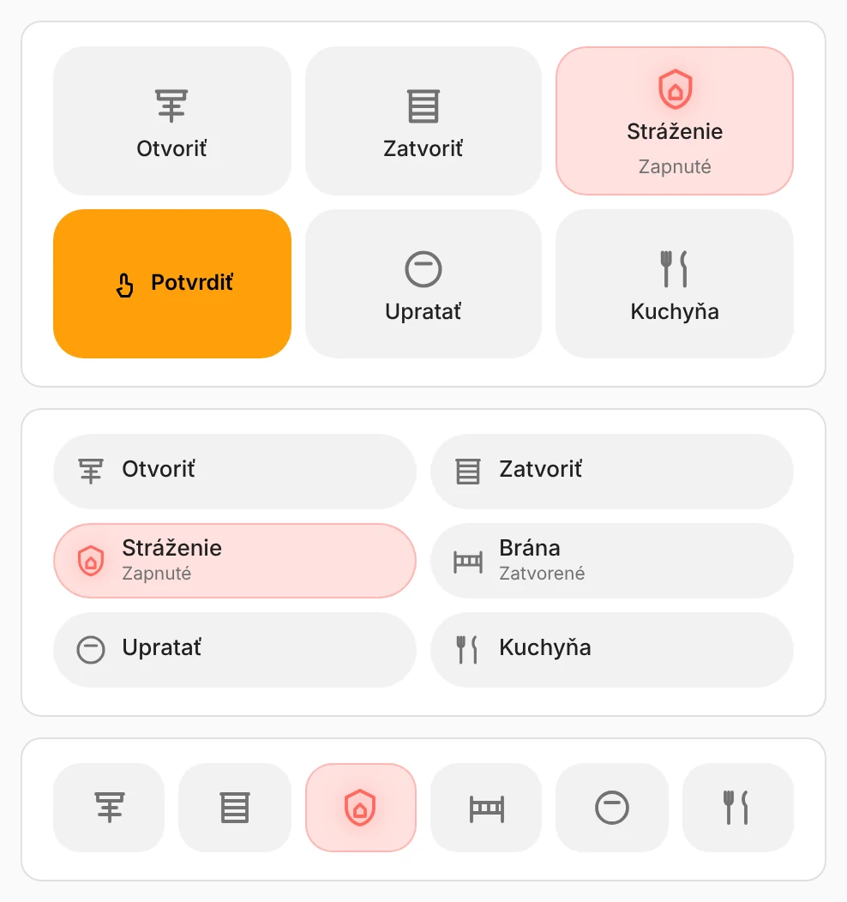
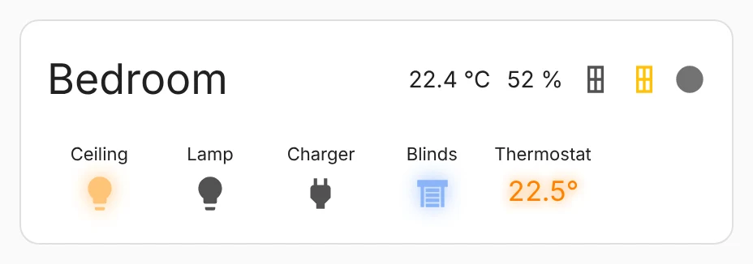
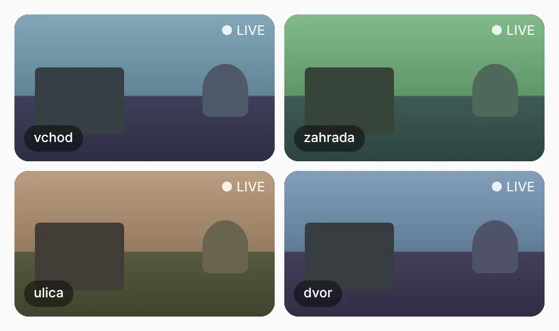
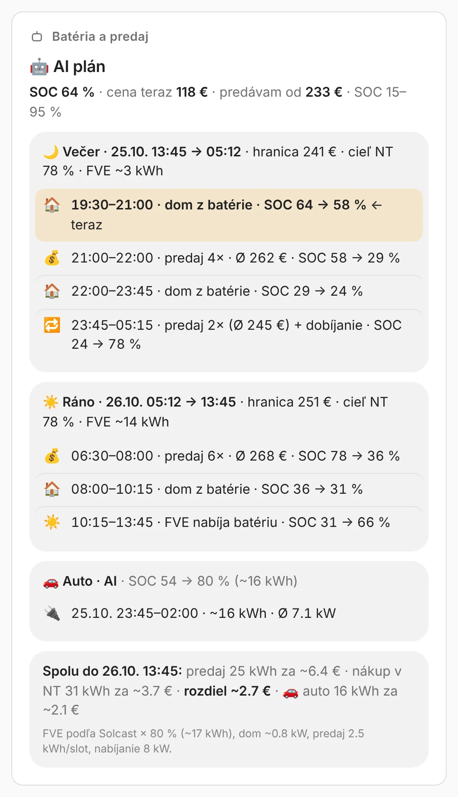

# Igy Cards

Ten custom Lovelace cards for Home Assistant in one shared visual style – energy, weather with PV forecast, heating, rooms, entities, buttons, markdown, electrical circuits, battery/BMS and cameras. All cards ship in a single file, so one HACS install gives you all of them.

> The card UI is in **Slovak** (built for a Slovak home with PV, battery and a gas boiler). Every card has a visual editor; nothing needs a build step or extra dependencies.



## Cards

| Card | Type | What it shows |
|---|---|---|
| Energy | `custom:igy-energy-card` | Live power flows (home, PV, battery, grid, gas, water, hot water) and a collapsible day / week / month / year overview from the Energy dashboard, incl. costs |
| Weather | `custom:igy-weather-card` | Scrollable hourly strip from midnight to tomorrow with history, sunrise/sunset and a PV-production ring per hour (Solcast), plus the next days |
| Thermostats | `custom:igy-thermostat-card` | Several climate entities in one card, 24 h heating-demand line, open-window warning |
| Room | `custom:igy-room-card` | One HA area: lights, temperature, humidity, windows, motion – entities are found from the area automatically |
| Entities | `custom:igy-entities-card` | Drop-in replacement for the Entities card with proper controls per entity type, groups and collapsible entities |
| Buttons | `custom:igy-buttons-card` | Buttons as tiles, pills or icons, optional confirm-by-second-tap |
| Markdown | `custom:igy-markdown-card` | Markdown/templates in the same style, `---` splits content into groups |
| Circuits | `custom:igy-circuits-card` | Power per circuit and phase, collapsible breaker groups |
| Battery | `custom:igy-battery-card` | Main battery meter (e.g. Victron SmartShunt) and a table of individual BMS (SOC, cell delta, temperature, cycles, balancing) |
| Cameras | `custom:igy-camera-card` | Camera grid via WebRTC (go2rtc / Frigate); tap opens full screen with fast low-res start, pinch zoom and pan. Requires [WebRTC Camera](https://github.com/AlexxIT/WebRTC) |

| | | |
|---|---|---|
|  |  |  |
|  |  |  |
|  |  |  |

Screenshots use the default Home Assistant light theme with sample data.

## Installation

### HACS (recommended)
1. HACS → ⋮ → **Custom repositories** → add `https://github.com/Igypop78/igy-cards`, type **Dashboard**.
2. Find **Igy Cards** in HACS and download it.
3. Reload the browser. HACS adds the resource `/hacsfiles/igy-cards/igy-cards.js` automatically.

### Manual
1. Download `igy-cards.js` from the [latest release](https://github.com/Igypop78/igy-cards/releases/latest) and copy it to `/config/www/`.
2. Settings → Dashboards → ⋮ → **Resources** → add `/local/igy-cards.js` as *JavaScript module*.

## Configuration

Every card can be configured in the visual editor. Minimal YAML examples:

```yaml
type: custom:igy-energy-card
home_power: sensor.home_power
solar_power: sensor.pv_power
battery_soc: sensor.battery_soc
battery_power: sensor.battery_power
grid_power: sensor.grid_power
```

```yaml
type: custom:igy-weather-card
entity: weather.forecast_home
solar_today: sensor.solcast_pv_forecast_forecast_today
solar_days:
  - sensor.solcast_pv_forecast_forecast_tomorrow
ring_max: 9          # kWh per hour for a full ring
```

```yaml
type: custom:igy-thermostat-card
title: Heating
entities:
  - entity: climate.living_room
  - entity: climate.bedroom
    window: binary_sensor.bedroom_window
```

```yaml
type: custom:igy-room-card
area: bedroom
collapsible: true
```

```yaml
type: custom:igy-entities-card       # same options as the core Entities card
title: EV charging
entities:
  - input_select.ev_mode
  - type: divider
  - entity: sensor.evse_state
    collapsed: true                    # hidden under "Ďalšie" together with neighbours
```

```yaml
type: custom:igy-buttons-card
layout: tiles                          # tiles / pills / icons
buttons:
  - entity: input_button.blinds_open
    name: Open blinds
  - entity: input_boolean.security
    confirm: true
```

```yaml
type: custom:igy-circuits-card
total: sensor.home_power
phases: [sensor.l1_power, sensor.l2_power, sensor.l3_power]
groups:
  - name: Breakers 3–8
    entity: sensor.breakers_3_8_power   # optional group total
    rows:
      - { entity: sensor.circuit_3_power, name: Kitchen, phase: L1 }
```

```yaml
type: custom:igy-battery-card
main:
  name: SmartShunt
  soc: sensor.smartshunt_soc
  power: sensor.smartshunt_power
  voltage: sensor.smartshunt_voltage
packs:
  - name: BMS 1
    power: sensor.bms_1_power
    soc: sensor.bms_1_state_of_charge
    delta: sensor.bms_1_delta_cell_voltage
    temp: sensor.bms_1_temperature_sensor_1
    balancing: sensor.bms_1_balancing   # JK BMS: 0 off, 1/2 balancing
```

```yaml
type: custom:igy-camera-card           # needs WebRTC Camera (AlexxIT) from HACS
columns: 2
cameras:
  - garden                             # go2rtc streams garden / garden_sub
  - name: entrance
    main: entrance_main
    sub: entrance_sub
    aspect: 16/9
poster: http://frigate:5000/api/{name}/latest.jpg?h=480   # optional still image while loading
```

All options of each card are described in the comment at the top of its source file in [`src/`](src).

### Theme
The cards use two optional theme variables for their inner surfaces:

```yaml
hc-surface: 'rgba(255,255,255,.06)'
hc-surface-line: 'rgba(255,255,255,.07)'
```

## Migrating from the previous names

| Old type | New type |
|---|---|
| `custom:home-energy-card` | `custom:igy-energy-card` |
| `custom:home-weather-card` | `custom:igy-weather-card` |
| `custom:multi-thermostat-card` | `custom:igy-thermostat-card` |
| `custom:area-room-card` | `custom:igy-room-card` |
| `custom:home-entities-card` | `custom:igy-entities-card` |
| `custom:home-buttons-card` | `custom:igy-buttons-card` |
| `custom:home-markdown-card` | `custom:igy-markdown-card` |
| `custom:home-circuits-card` | `custom:igy-circuits-card` |
| `custom:home-battery-card` | `custom:igy-battery-card` |
| `custom:kamery-card` | `custom:igy-camera-card` |

The options are unchanged – only `type` changes. Remove the old per-card resources afterwards.

## Development

Cards live in `src/`. `dist/igy-cards.js` is built by concatenating them:

```sh
node scripts/build.js          # build
node scripts/build.js --check  # verify dist is up to date (CI)
```

A release is created automatically when `version` in `package.json` changes on `main` (tag `vX.Y.Z`, notes from `CHANGELOG.md`, `igy-cards.js` attached).

## License

MIT
